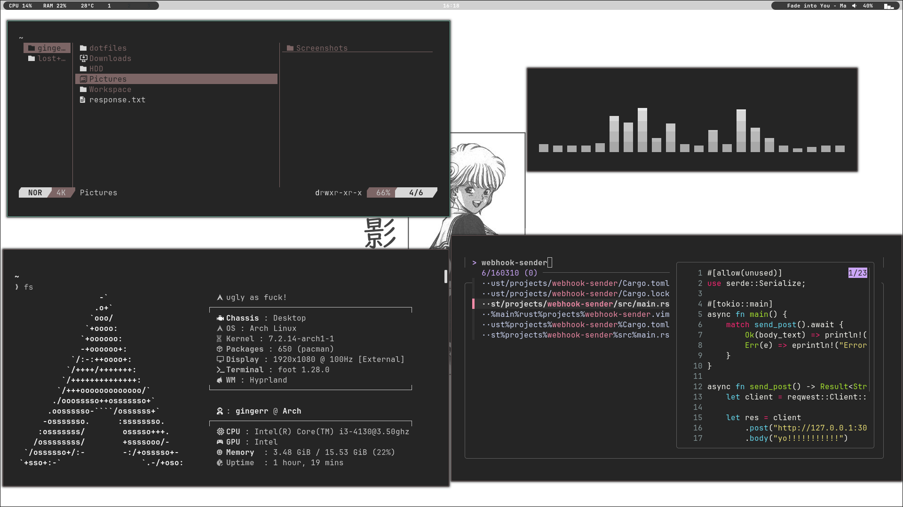
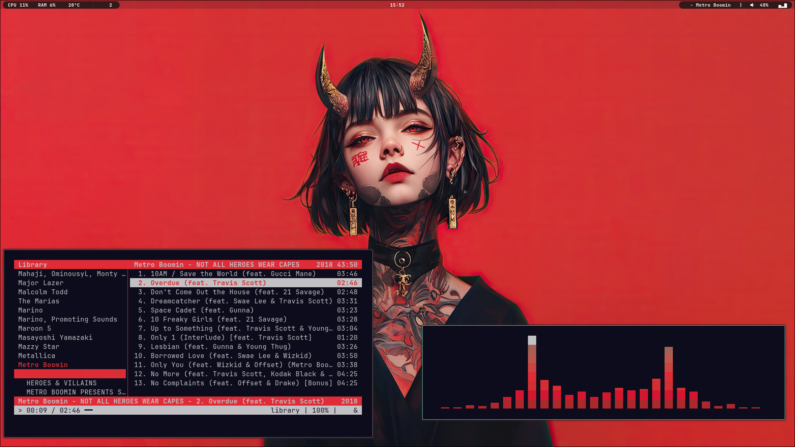
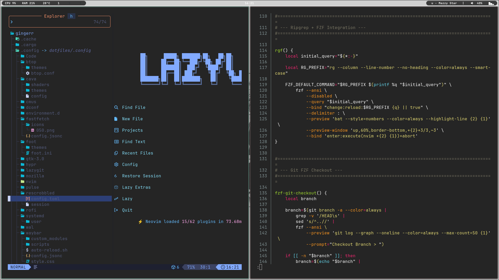
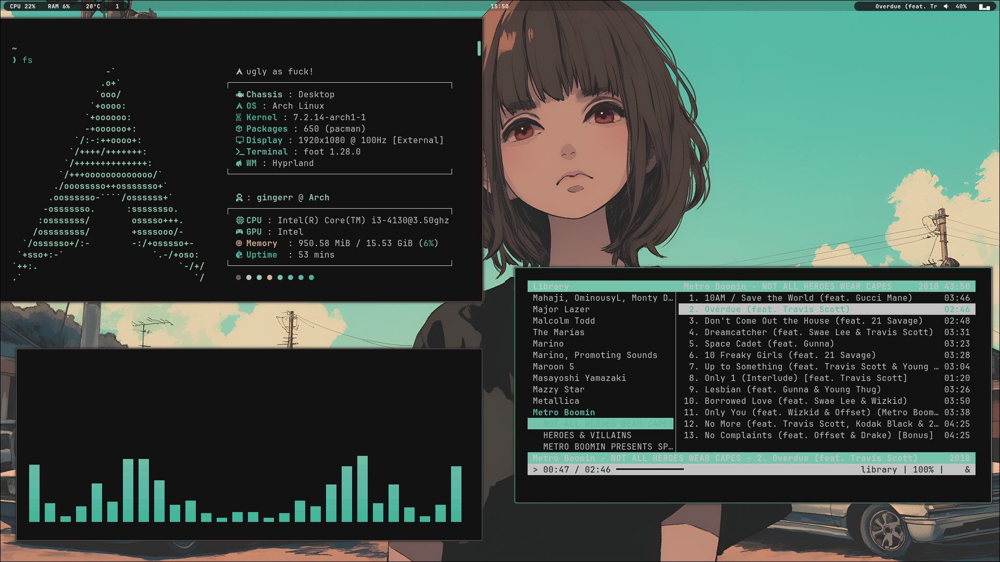

# Dotfiles

## Screenshots

### Desktop









## Neovim

My Neovim setup is built on **LazyVim** and organized as small Lua modules. The entry point bootstraps LazyVim and loads my editor options, keymaps, and LSP setup. Plugin files are grouped by purpose, and the plugin loader recursively discovers and loads Lua modules, so adding a plugin module does not require maintaining a separate import list.

The configuration includes language tooling, completion, formatting, testing, debugging, Git tools, and editor utilities.

```text
.config/nvim/
├── init.lua
├── lazyvim.json
├── lazy-lock.json
├── snippets/
└── lua/mine/
    ├── config/       # Options, keymaps, autocmds
    ├── dap/          # Debugging
    ├── languages/    # Language-specific setup
    ├── lazy/         # Lazy.nvim bootstrap
    ├── lsp/          # LSP, Mason, diagnostics
    ├── plugins/
    │   ├── init.lua  # Recursively loads nested plugin modules
    │   ├── coding/
    │   ├── editor/
    │   ├── git/
    │   ├── tools/
    │   └── ui/
    └── theme/
```

## Zsh tools

The Zsh setup brings together **ripgrep**, **fzf**, and **bat** for quick, interactive workflows. `rgf` searches with ripgrep and lets you preview matches with bat or open them directly in Neovim. Fzf also powers file, directory, and history pickers with previews. Custom helpers include `fzf-git-checkout` for choosing branches and `mkcd` for creating and entering a directory; aliases provide quick access to common tools.

```text
.zshrc     # Shell setup, fzf integrations, helpers, aliases, and keybindings
.zprofile  # Loads .zshrc
```

## Hyprland

Hyprland is configured in Lua and split into focused modules for appearance, animations, input, window rules, startup, and keybindings. Ergonomic home-row shortcuts use **Alt + H/L** for left/right and **Alt + J/K** for up/down focus; add **Shift** to move windows instead. Alt-based shortcuts also launch common apps and control workspaces.

```text
.config/hypr/
├── hyprland.lua          # Loads the Lua modules
└── lua/
    ├── animations.lua
    ├── appearance.lua
    ├── autostart.lua
    ├── input.lua
    ├── keybinds.lua
    └── rules.lua
```

## Waybar

Waybar is a compact, custom status bar for Hyprland with system stats, workspaces, clock, audio controls, and custom media title and visualizer modules. Its styling is defined in CSS; **Waybar is not configured to use Pywal**.

```text
.config/waybar/
├── config.jsonc
├── style.css
├── auto-reload.sh
├── custom_modules/
│   └── media/
│       ├── media-animation.sh
│       └── media-now-playing.sh
└── scripts/
    └── gpu_usage.sh
```

## Foot

Foot is configured as a lightweight Wayland terminal, with its server started when the Hyprland session launches so terminal windows can reuse it. Its color scheme integrates with Pywal.

```text
.config/foot/
├── foot.ini
└── themes/
    └── pywal.conf
```

## Fastfetch

Fastfetch has a custom layout, logo, and system-information display. The teal screenshot shows **650 Pacman packages**; this setup also uses **2 AUR packages installed with yay**.

```text
.config/fastfetch/
├── config.jsonc
└── icons/
```

## Wallpaper and Pywal

The `rofi-wallpaper` script presents wallpaper categories and choices in Rofi. `setwal` applies the selected image through **awww**, generates a matching Pywal palette, and signals Foot and Cava to refresh. The awww daemon is started with the Hyprland session.

```text
.local/bin/
├── rofi-wallpaper
└── setwal

.config/wal/templates/
├── cava-colors
├── foot-colors.ini
├── hyprland.lua
└── rofi.rasi
```

## Rofi

Rofi is configured as an application, run, window, and file launcher, with a custom launcher layout and Pywal color theme. The wallpaper picker uses this launcher styling too.

```text
.config/rofi/
├── config.rasi
├── colors/
│   ├── nord.rasi
│   └── pywal.rasi
└── launchers/
    └── type-6/
        ├── launcher.sh
        └── style-6.rasi
```

## Yazi

Yazi uses a Pywal theme for colors that match the current wallpaper.

```text
.config/yazi/
└── theme.toml
```

## Cava

Cava is themed through Pywal and includes custom shader presets.

```text
.config/cava/
├── config
├── shaders/
└── themes/
```

## cmus

cmus is included as a local, terminal-based music player, with a saved default playlist.

```text
.config/cmus/
└── playlists/
    └── Default
```

## Setup

This repository **does not include an installation script**. Choose the configurations you want and link or copy them into the appropriate locations on your system. Some settings are specific to this machine and may need adjustment.

## License

This project is licensed under the MIT License. See [LICENSE](LICENSE).
